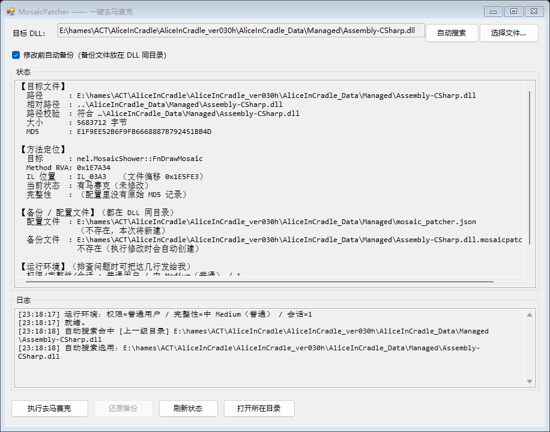

# MosaicPatcher

> 一键关闭《Alice in Cradle》的马赛克显示（去马赛克）。
> One-click patcher that disables the mosaic filter in *Alice in Cradle*.



## 它做什么

把游戏 `Assembly-CSharp.dll` 里 `nel.MosaicShower::FnDrawMosaic` 方法**末尾**的

```csharp
return true;    // 画马赛克
```

改成

```csharp
return false;   // 不画马赛克
```

只翻 **1 个字节**（IL `ldc.i4.1` `0x17` → `ldc.i4.0` `0x16`），**文件长度不变、其余字节一个都不动**。

| 状态 | 含义 |
|---|---|
| **有马赛克（未修改）** | 原版状态 |
| **无马赛克（已去马赛克）** | 已修改，游戏不再绘制马赛克 |

## 特性

- **自动搜索**游戏目录：程序目录 / 上一级目录(1 层) / 所有子目录，且**只认**路径形如
  `…\AliceInCradle_Data\Managed\Assembly-CSharp.dll` 的文件（避免改错别的同名 DLL）
- **自己解析 PE / .NET 元数据**定位方法，不依赖 dnSpy / dnlib，也不联网
- **自动备份 + 一键还原 + MD5 校验**：能发现备份或 DLL 是否被其它程序改动过
- **健壮的写入策略**：常规覆盖失败时自动改用「改名换位」替换（就是资源管理器"替换"的原理），
  失败自动回滚；只读属性自动清除
- **单文件 exe**：C# 编写，约 67 KB，免安装、不自解压，只依赖系统自带的 .NET Framework 4.8
- 另有 **Python 脚本版**（需要 Python 3.8+，自带 tkinter）
- 支持命令行，便于脚本化

## 下载 / 使用

1. 到 [Releases](../../releases) 下载 `MosaicPatcher.exe`
2. 放到**游戏根目录**（与 `AliceInCradle_Data` 同级）——放别处也行，它会自动搜索
3. 双击运行 → 自动选中游戏的 `Assembly-CSharp.dll` → 点 **「执行去马赛克」**
4. 想恢复原状，点 **「还原备份」**

> **关于 Windows 提示**：exe 未做代码签名，首次运行可能被 SmartScreen 拦一次
> （点「更多信息」→「仍要运行」即可）。不想看到提示，可以改用 `运行.bat` 或
> `MosaicPatcher.pyw` —— 它们跑在已签名的 `python.exe` 上，不会有提示。

### 会生成什么文件（都在 DLL 同目录）

| 文件 | 说明 |
|---|---|
| `Assembly-CSharp.dll.mosaicpatch.bak` | 备份，首次修改时创建，之后**永不覆盖** |
| `mosaic_patcher.json` | 记录备份状态与各种 MD5 |

## 命令行

```text
MosaicPatcher.exe --find [--base <目录>]        自动搜索并列出候选
MosaicPatcher.exe --status  <dll>               查看状态（只读）
MosaicPatcher.exe --patch   <dll> [--no-backup] 执行去马赛克
MosaicPatcher.exe --restore <dll> [--force]     还原备份
MosaicPatcher.exe --gui-selftest                界面自检
MosaicPatcher.exe <任意命令> --out <文件>        把输出写进文件
```

## 从源码构建

### C# 版（推荐，不需要安装任何 SDK）

需要 .NET Framework 4.x 自带的编译器，Windows 系统都有：

```bat
build.bat
```

或者手动执行：

```bat
"%WINDIR%\Microsoft.NET\Framework64\v4.0.30319\csc.exe" /nologo /target:winexe ^
  /platform:anycpu /optimize+ /codepage:65001 /win32icon:icon.ico ^
  /out:MosaicPatcher.exe ^
  /reference:System.dll /reference:System.Core.dll ^
  /reference:System.Drawing.dll /reference:System.Windows.Forms.dll ^
  MosaicPatcher.cs
```

### Python 版

需要 Python 3.8+（官方安装包自带 tkinter）：

```bash
python MosaicPatcher.pyw
```

## 原理

1. 解析 PE 头找到 CLI 头 → 元数据根 → `#~` 表流；
2. 读 `TypeDef` / `MethodDef` 表，定位 `nel.MosaicShower::FnDrawMosaic` 的方法体；
3. 解析 IL 指令流，校验末尾是 `ret`，且前一条是 `ldc.i4.1`；
4. 把该字节改成 `0x16`（`ldc.i4.0`）并写回。

## 常见问题

**Q：日志显示「完整性=低 Low」，文件写不进去 / explorer 报 0xc0000142？**
说明所在目录被打了「低完整性 + 禁止向上写」的限制标签，程序会以低权限运行。
右键以管理员身份运行 `修复完整性标签.bat` 即可恢复。

**Q：提示「文件被其它程序占用」？**
先完全退出游戏。程序会自动重试并改用「替换」方式写入；如果仍失败，检查任务管理器里
有没有残留的 `UnityCrashHandler64`。

**Q：定位不到方法？**
说明 DLL 不是这个版本，或不是 Alice in Cradle 的 `Assembly-CSharp.dll`。
程序在定位失败时会**明确报错并且不做任何修改**。

## 免责声明

- 本工具只修改**你自己电脑上**的游戏文件，**不包含也不分发**任何游戏本体、资源或代码片段。
- 请自行确认你已合法拥有该游戏，并遵守其最终用户许可协议（EULA）。
- 本工具与游戏开发商 / 发行商**没有任何关联**，也未获其授权或认可。
- 使用本工具产生的一切后果由使用者自行承担。

## License

[MIT](LICENSE)
